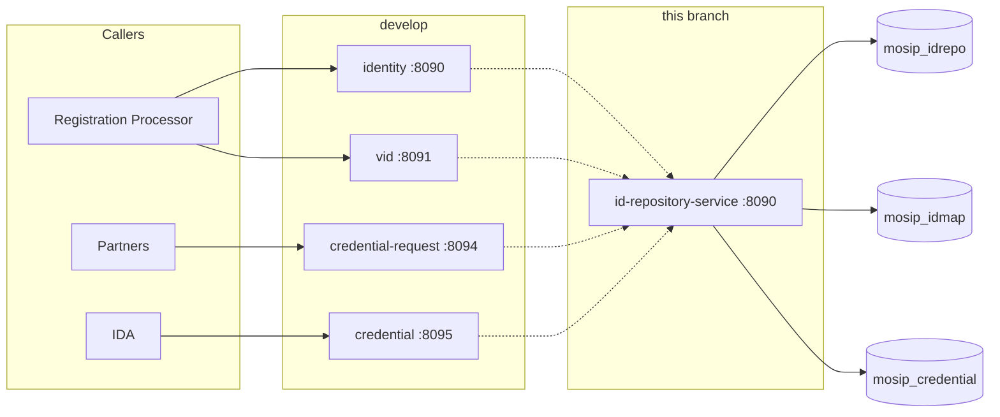

# Consolidating ID Repository into one service

Branch [`IDREPO-1583-consolidate-idrepo-services`](https://github.com/mosip/id-repository/tree/IDREPO-1583-consolidate-idrepo-services) folds the four HTTP services on [`develop`](https://github.com/mosip/id-repository/tree/develop) into one JVM. Callers keep the same URLs. The three databases stay separate. Salt generation stays a one-shot Job.

---

## What develop looked like

`develop` builds and deploys one process per domain. Each process has its own Maven module, image, port, and Helm chart.

| Service on `develop` | Maven module | Port | Public prefix |
|---|---|---|---|
| Identity | `id-repository-identity-service` | 8090 | `/idrepository/v1/identity` |
| VID | `id-repository-vid-service` | 8091 | `/idrepository/v1` |
| Credential request | `credential-request-generator` | 8094 | `/v1/credentialrequest` |
| Credential store | `credential-service` | 8095 | `/v1/credentialservice` |
| Salt generator | `id-repository-salt-generator` | — (Job) | — |
| Credential feeder | `id-repository-credentials-feeder` | — (Job) | — |

`id-repository-core` is a library, not a service. Identity, VID, and credential already shared it.

Helm charts on `develop`: `identity`, `vid`, `credentialrequest`, `credential`, `idrepo`, `credentialfeeder`, `idrepo-saltgen`.

---

## What this branch deploys

One HTTP process, `id-repository-service`, listens on **8090**. Identity, VID, credential request, and credential store run inside it. `id-repository-core` stays a published library. `id-repository-salt-generator` stays its own module and is still installed only as the `helm/idrepo-saltgen` Job.

```text
develop                              this branch
─────────────────────────            ─────────────────────────
identity-service      :8090          id-repository-service :8090
vid-service           :8091            identity + vid
credential-request    :8094            + credential request
credential-service    :8095            + credential store
salt-generator Job                   salt-generator Job (unchanged)
credential-feeder Job                not part of this service
```

Maven reactor modules are `id-repository-core`, `id-repository-service`, and `id-repository-salt-generator`. Helm charts that remain are `helm/identity` (the HTTP service) and `helm/idrepo-saltgen`. `deploy/idrepo/install.sh` installs the `identity` chart only.

The credential feeder is not in the reactor and has no chart on this branch. Its `deploy/credential-feeder` scripts are still in the tree; they are not part of the consolidated service.

---

## Approach

### 1. Move code, do not rewrite the APIs

Domain packages moved into `id-repository-service` as they were:

* `io.mosip.idrepository.identity` — identity and draft
* `io.mosip.idrepository.vid` — VID
* `io.mosip.idrepository.credential.request` — credential request
* `io.mosip.idrepository.credential.store` — credential issuance

Controllers keep relative mappings (`/`, `/v2`, `/vid`, `/issue`, …). `IdRepoApiPathConfig` adds the old public prefix per controller type, so Registration Processor, IDA, partners, and `api-test` call the same URLs as on `develop`.

| Prefix | Controllers |
|---|---|
| `/idrepository/v1/identity` | `IdRepoController`, `IdRepoDraftController`, `VidEventCallbackController` |
| `/idrepository/v1` | `VidController` |
| `/v1/credentialservice` | `CredentialStoreController` |
| `/v1/credentialrequest` | `CredentialRequestGeneratorController` |

The servlet root stays `/`. The Istio `VirtualService` on the `identity` chart matches all four prefixes and sends them to this one Service. On `develop` those prefixes were split across four Services.

WebSub topic names are unchanged: `{partnerId}/CREDENTIAL_ISSUED` and `CREDENTIAL_STATUS_UPDATE`. The Keycloak client remains `mosip-idrepo-client`.

### 2. One process, three databases

Schemas are not merged. Salt tables are not merged. `IdRepoLibraryConfig` wires three persistence units in the same JVM:

| Unit | Database | What it holds | Wired by |
|---|---|---|---|
| PU1 (primary) | `mosip_idrepo` | UIN, drafts, handles, identity salts | `IdRepoDataSourceConfig` via `IdRepoConfig` |
| PU2 | `mosip_idmap` | VID and its own salt tables | `VidRepoConfig` |
| PU3 | `mosip_credential` | credential store and `BATCH_*` | `credentialDataSource()` |

Each unit has its own datasource, entity manager, and transaction manager. A credential transaction does not enlist the identity database.

`uin_hash_salt` and `uin_encrypt_salt` still exist in both `mosip_idrepo` and `mosip_idmap`. They are filled only by the salt-generator Job. The HTTP process does not generate salts, and IDA's `ida.uin_hash_salt` is a different table.

### 3. Narrow component scan

`IdRepositoryBootApplication` imports `HttpModeScanConfiguration` instead of scanning `io.mosip.kernel` as a whole. `kernel-core` contains `@Component` types (Orika mappers, ID generators) whose constructors are not Spring beans and that expect JPA repositories this service does not ship. Scanning the whole package prevents startup.

The scan is limited to `io.mosip.idrepository` plus the kernel and commons packages this service actually uses: WebSub, retry, UIN/VID/RID validators, the ID-object validator, CBEFF, BioSDK, Khazana, and the auth adapter. Unused kernel auto-configurations are listed on `excludeName`. Datasource and credential `@Configuration` classes that `IdRepoLibraryConfig` already imports are excluded from the scan so they are not registered twice.

Salt-generator types (`io.mosip.idrepository.saltgenerator`) are outside this scan. They run only in the Job.

### 4. One config-server application, several property documents

`spring.application.name` is `id-repository`. The process still imports the old documents:

```properties
spring.cloud.config.name=application,id-repository,credential-service,credential-request
```

Existing `id-repository-default.properties`, `credential-service-default.properties`, and `credential-request-default.properties` keep working. Role keys stay namespaced (`mosip.role.idrepo.identity.*`, credential roles, and so on).

A key that appears in more than one of those documents has a single value in this JVM. The service-specific document overrides `application-default.properties`. On `develop` each process only saw its own document, so the same key could differ per service. After consolidation it cannot.

### 5. Deploy order

Unchanged in spirit, fewer charts:

1. Databases (`db_scripts` for a fresh install, `db_upgrade_scripts` for an upgrade).
2. `helm/idrepo-saltgen` and wait until the Job completes.
3. `helm/identity` — one Deployment, port 8090.

Probes and the ServiceMonitor use `/idrepository/v1/identity/actuator/health`. The old health URLs on 8091, 8094, and 8095 are gone. Monitors and the gateway must point at 8090 and at the four prefixes above.

---

## What did not change

* REST paths listed in the table above, including `/idrepository/v1/identity/v2` and `/idrepository/v1/vid`.
* WebSub topic names and the `mosip-idrepo-client` Keycloak client.
* Database names, schema ownership, and the rule that salts are loaded by the Job.
* `id-repository-core` as the library other MOSIP services (IDA) depend on.
* `api-test` endpoint paths. The rig still calls the four prefixes; it does not need a new base URL per domain.

A schema change still lands in `db_scripts`, `db_upgrade_scripts`, and `db_release_scripts` (with rollback). An API change still updates `api-test` and `api-docs`.

---

## Consequences

* **One failure domain.** A crash, a bad deploy, or an out-of-memory error stops identity, VID, and credential together. On `develop` the other three processes kept serving.
* **Shared resources.** Identity reads, VID updates, and credential batch work share one heap, one Tomcat pool, and one auth filter. Pool sizes are still configured per database (`mosip.idrepo.db.pool.*` and the credential pool), but CPU and memory are not.
* **Config collisions.** See section 4. A property added for one old service can now override the shared default for every API in the process.
* **Gateway.** All four prefixes must route to the `identity` Service. A route left pointed at the removed `vid`, `credential`, or `credentialrequest` Service will 404.
* **Health.** Cluster probes belong on `/idrepository/v1/identity/actuator/health` of the single pod.


